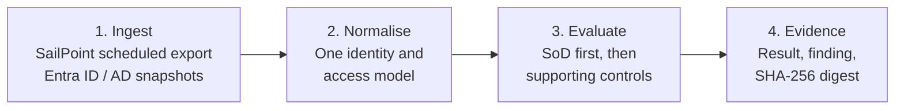

# IATO: IAM Control Evaluation Framework (CEF) v1.0.0



The framework observes and reports. It does not modify source systems, perform remediation, or replace SailPoint, Entra ID or a PAM platform.

## SailPoint IdentityIQ input

SailPoint IdentityIQ (IIQ) stores many of its configuration objects in XML. CEF recognises these object types:

| XML object | What it represents |
|---|---|
| `<Rule>` | Custom business logic and processing rules |
| `<TaskDefinition>` | Scheduled or executable tasks |
| `<EmailTemplate>` | Notification templates |
| `<sailpoint>` | Wrapper containing multiple SailPoint objects |

For example, an exported SailPoint configuration might contain:

```xml
<!DOCTYPE sailpoint ...>
<sailpoint>
    <Rule name="SoDValidation">
        ...
    </Rule>

    <TaskDefinition name="AccessReview">
        ...
    </TaskDefinition>

    <EmailTemplate name="AccessAlert">
        ...
    </EmailTemplate>
</sailpoint>
```

This is configuration and governance metadata, not simply a list of employees. The framework is interested in understanding the identity controls and governance relationships represented by the source system.

## Intended process

1. **Export from SailPoint.** An administrator exports the relevant IdentityIQ objects. CEF receives the XML as a read-only input.
2. **Parse and extract.** The framework interprets the XML structure and extracts relevant identities, accounts, roles, entitlements, rules and governance relationships.
3. **Normalise the data.** Vendor-specific structures are converted into a common identity model, so evaluation logic does not depend on whether the data came from SailPoint, Entra ID or AD.
4. **Evaluate the controls.** OPA/Rego evaluates the normalised data against defined assertions.
5. **Generate evidence.** The result is recorded, hashed with SHA-256 and can be written to an immutable evidence store.

### Data sources

The design is hybrid: a scheduled export for SailPoint, and on-demand read-only snapshots for the Microsoft platforms.

| Source | How data is obtained |
|---|---|
| SailPoint IGA | Scheduled export (XML) |
| Microsoft Entra ID | Live read-only snapshot via collector script (Microsoft Graph API) |
| Active Directory | Live read-only snapshot via collector script |

The collectors actively pull current state (users, privileged role assignments and eligibility, MFA methods, Conditional Access policies and so on) rather than relying on a scheduled dump for Entra and AD.

## Example: privileged account MFA

The repository contains working policy files. `IATO-AC-012.rego` checks whether privileged accounts have MFA enabled. For example, the normalised input might look like:

```json
{
  "accounts": [
    {
      "id": "admin@example.com",
      "privileged": true,
      "mfa_enabled": false
    }
  ]
}
```

The policy evaluates:

```
account.privileged == true
account.mfa_enabled != true
```

If both conditions are true, it produces a finding:

> privileged account admin@example.com does not have MFA enabled

`IATO-AC-013.rego` checks for standing privileged access in the same way. Because the policies run against the normalised model, they apply to whichever source populates the relevant fields.

See:
- [IATO-AC-012 (MFA policy)](https://github.com/whatheheckisthis/Intent-to-Auditable-Trust-Object-Index/blob/main/policies/ac/IATO-AC-012.rego)
- [IATO-AC-013 (privileged access policy)](https://github.com/whatheheckisthis/Intent-to-Auditable-Trust-Object-Index/blob/main/policies/ac/IATO-AC-013.rego)
- [Entra ID collector](https://github.com/whatheheckisthis/Intent-to-Auditable-Trust-Object-Index/blob/main/collectors/azure/entra_snapshot.py)

## Implementation status

| Component | Status |
|---|---|
| Entra ID collector | Implemented |
| `IATO-AC-012`, `IATO-AC-013` | Implemented |
| Active Directory collector | Scaffolded <!-- VERIFY: ad_snapshot.py not opened --> |
| SailPoint XML parser and normaliser (steps 2 and 3) | Planned |
| SoD, entitlement, certification and migration policies | Planned <!-- VERIFY: check policies/ for other .rego files --> |
| Evidence hashing and ledger | Scaffolded <!-- VERIFY: evidence/ and ledger/scripts not opened --> |

"Planned" means designed and documented but not yet built.

Scope note: which controls the SailPoint input can support depends on the object type. `Rule`, `TaskDefinition` and `EmailTemplate` describe governance configuration, so they support assertions such as "an access review task is defined and scheduled". Account-level fields such as `mfa_enabled` come from the platforms that hold authentication state (Entra, AD), which is why the hybrid model joins sources in the common identity model.

## Normalised model

```
identity ─► account ─► application ─► role ─► entitlement
identity ─► reviewer ─► certification ─► decision
```

## Control assertions

Controls use internal identifiers (`IATO-<domain>-<sequence>`). Domains: `AC` access control, `AU` authentication, `EN` entitlement management, `GV` identity governance, `PA` privileged access, `SD` segregation of duties, `IM` identity migration.

Rego examples (OPA 1.x syntax):

```rego
package iato.ac.iato_ac_012

import rego.v1

deny contains msg if {
	some account in input.accounts
	account.privileged == true
	account.mfa_enabled != true
	msg := sprintf("IATO-AC-012 failed: privileged account %q does not have MFA enabled", [account.id])
}
```

```rego
package iato.ac.iato_ac_013

import rego.v1

deny contains msg if {
	some account in input.accounts
	account.privileged == true
	account.standing_privileged_access == true
	msg := sprintf("IATO-AC-013 failed: privileged account %q has standing privileged access", [account.id])
}
```

## Evidence

Each evaluation produces a structured record: control ID, evaluated identity state, assertion, outcome, timestamp and a SHA-256 digest. Records can be written to an immutable evidence store. Evidence describes findings only. It is not an access decision or remediation action.

```yaml
evidence:
  control_id: IATO-AC-012
  evaluation:
    result: fail
    timestamp: recorded
  integrity:
    algorithm: SHA-256
    digest: recorded
```

## Known limitations

- **MFA is measured as registration, not enforcement.** The Entra collector sets `mfa_enabled` when the user has any registered method other than a password. Conditional Access policies are collected but not yet evaluated.
- **Standing access.** The collector reads `roleAssignmentScheduleInstances`, which includes PIM-activated assignments. Filtering on `assignmentType == "Assigned"` is planned so just-in-time activations are not reported as standing.
- **Group-assigned roles and non-user principals** are not yet expanded.
- **Scale.** One authentication-methods request is made per user, with no throttling or retry handling.

## Read-only operation

```yaml
source_environment:
  read: permitted
  create: prohibited
  update: prohibited
  delete: prohibited
output:
  analysis: permitted
  evidence_generation: permitted
  remediation: out_of_scope
```

## Framework alignment

| Framework | Use |
|---|---|
| **NZISM** | Control reference for identity management, authentication, access control, privileged access and access governance in NZ government and regulated environments |
| **ISM (AU)** | Control reference for authentication, privileged access, entitlement governance and identity assurance in AU government and enterprise environments |
| **Essential Eight** | IAM-relevant strategies: restrict administrative privileges, multi-factor authentication |

- Which frameworks apply depends on the client.
- Framework references provide context only. They create no compliance obligations and do not replace formal assessment.

## Roadmap

1. SailPoint IIQ XML parser and normaliser
2. Governance-configuration assertions over `Rule` and `TaskDefinition`
3. Conditional Access evaluation for AC-012
4. `assignmentType` filtering and group expansion in the Entra collector
5. SoD and entitlement policies; migration drift comparison
