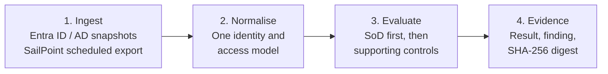

# CEF v1.0.0: IAM Control Evaluation Framework

A read-only Segregation of Duties (SoD) assurance model for hybrid IAM environments, classifying access combinations as toxic or non-toxic.

A toxic combination is a set of entitlements that should not be held by the same identity, for example, the ability to both create and approve a payment.

CEF reads identity and access data from Microsoft Entra ID, Active Directory and SailPoint IGA, combines it into one model, evaluates it against defined controls, and records each result as evidence. Controls for privileged access, access certification, entitlement management, authentication and migration assurance are evaluated on the same model.

CEF assesses and reports only. Any uplift is delivered through established IAM operational and change-management processes. CEF is self-directed portfolio work.

## How it works




### 1. Ingest

| Source | How data is obtained |
| ------ | -------------------- |
| SailPoint IGA | Scheduled export (XML) |
| Microsoft Entra ID | Live read-only snapshot via collector script (Microsoft Graph API) |
| Active Directory | Live read-only snapshot via collector script |

SailPoint is the only source delivered as a scheduled export, commonly in XML. Entra ID and Active Directory are read directly instead: the collector scripts take a live, read-only snapshot of current state, such as users, privileged role assignments and eligibility, MFA methods and Conditional Access policies, so no scheduled dump is needed.

Ingestion is therefore **hybrid**. SailPoint data arrives on a schedule, and the Microsoft platforms are queried on demand. All 
Collectors hold read permissions only.

**SailPoint XML export format**

SailPoint objects are held as XML text files. Each object type is represented by its own XML tag and has its own structure:

| Tag | Object |
| --- | ------ |
| `<Rule>` | Rules |
| `<TaskDefinition>` | Tasks |
| `<EmailTemplate>` | Email templates |
| `<sailpoint>` | Wrapper element that holds one or more objects |

A file holding a single object starts with a `DOCTYPE` declaration for that object type, and begins and ends with that object's tag:

```xml
<!DOCTYPE Rule ...>
<Rule ...>
  ...
</Rule>
```

The better practice is to wrap objects in a `<sailpoint>` element. The file then declares `sailpoint` as its document type and can hold several objects, which are imported together:

```xml
<!DOCTYPE sailpoint ...>
<sailpoint>
  <Rule ...> ... </Rule>
  <EmailTemplate ...> ... </EmailTemplate>
</sailpoint>
```


CEF treats the scheduled export as read-only input in this format.

### 2. Normalise

Each source has its own schema. CEF converts all of them into one model so the control logic does not depend on any vendor format.

```yaml
identity:
  account:
    application:
      role:
        entitlement:

# governance relationships
identity:
  reviewer:
    certification:
      decision:
```

### 3. Evaluate

SoD is the core function. Each control is an explicit assertion tested against the normalised model. Because the model combines all sources, a toxic combination can be found across platforms, for example a SailPoint-exported entitlement combined with an Entra ID role or Active Directory group membership.

```yaml
control:
  control_id: IATO-SD-001
  domain: segregation_of_duties
  assertion: conflicting_entitlements_must_not_be_assigned
```
>Controls are grouped into seven domains. The grouping follows the control families that established frameworks use for identity and access management, so each domain can be referenced against NZISM, ISM and SOC 2 logical access requirements without changing the controls themselves. It also mirrors the RBAC model of identities, roles, entitlements and assignments, and every control carries the same metadata fields (control_id, domain and assertion), which keeps evidence records consistent and traceable. Framework references are context only and do not create compliance obligations. The table below shows each domain in order, with each row indicating how the control maps to the relevant family, RBAC concept and supporting metadata.


| ID | Domain | What is evaluated |
| -- | ------ | ----------------- |
| `IATO-SD` | Segregation of Duties | Conflicting entitlement combinations are not assigned |
| `IATO-PA` | Privileged Access | Privileged identities, accounts and assignments are attributable, approved and reviewed |
| `IATO-GV` | Identity Governance | Governance relationships, including certification decisions |
| `IATO-EN` | Entitlement Management | Entitlements are attributable and reviewable |
| `IATO-AC` | Access Control | Active access has an attributable identity relationship |
| `IATO-AU` | Authentication | Authentication-related control state |
| `IATO-IM` | Identity Migration | State differences between legacy IAM and Entra ID / Azure RBAC targets |

>Ownership and exceptions. CEF evaluates against a conflict matrix; it does not decide what is toxic. In line with standard IGA practice, the matrix is owned by the business or application owner and approved through the organisation's access governance process, and toxic pairs are risk-rated by that control owner. Approved exceptions and compensating controls remain governance records held by the control owner, with documented justification and a review date. CEF reports the combination as found, and the exception is assessed against that finding through established IAM processes.

Conflict definitions are policy inputs under `policies/sod`, kept separate from collected identity state. OPA/Rego is the policy evaluation mechanism where policy-as-code is used.

### 4. Evidence

Every evaluation produces a record linking source state to result.

```yaml
evidence:
  control_id: IATO-SD-001
  identity_state:
    identity: recorded
    account: recorded
    entitlement_relationships: recorded
  assertion:
    definition: recorded
  evaluation:
    result: fail
    timestamp: recorded
  integrity:
    algorithm: SHA-256
    digest: recorded
```

An evidence record is not an access decision or a remediation action.

## Migration assurance

CEF compares a captured legacy IAM state against an Entra ID / Azure RBAC target state and reports:

- Missing identities and orphaned accounts
- Missing entitlements and unexpected role assignments
- Access relationship and privilege changes
- SoD differences
- Legacy access remaining after migration

CEF observes and compares. It does not perform the migration.

## Constraints

| Constraint | Detail |
| ---------- | ------ |
| Read-only | Read permitted on source environments. Create, update and delete prohibited. |
| No remediation | Out of scope by design. Findings go to established IAM operational and change-management processes. |
| Not a SailPoint replacement | SailPoint is treated as the enterprise IGA platform. CEF does not reproduce proprietary SailPoint functionality. |
| Framework references are context | Mappings are maintained separately from control implementation. They create no compliance obligations and do not replace formal assessment. |

## Framework alignment

| Framework | Relevant areas |
| --------- | -------------- |
| NZISM | Identity management, authentication, access control, privileged access, identity assurance, access governance |
| ISM | Identity and access management, authentication, privileged access, access control, identity assurance |
| Essential Eight | Restrict Administrative Privileges, Multi-Factor Authentication |

The control crosswalk is in `docs/IAM_CONTROL_CROSSWALK.csv`. Internal `IATO` control IDs are independent of external framework numbering.

## Repository structure

```text
iato-root/
├── .github/workflows/   validate.yml, ledger-commit.yml
├── docs/                IAM_CONTROL_CROSSWALK.csv, IDENTITY_DATA_MODEL.md,
│                        images/sailpoint-xml-object-structure.png
├── collectors/          azure/entra_snapshot.py, active_directory/ad_snapshot.py
├── policies/            access, authentication, entitlement, governance, privileged, sod
├── test/                mutations, unit
├── evidence/            generate_evidence.py, schemas
├── ledger/              scripts/hash_result.py, scripts/append_ledger.py, storage/README.md
└── requirements.txt
```

---
