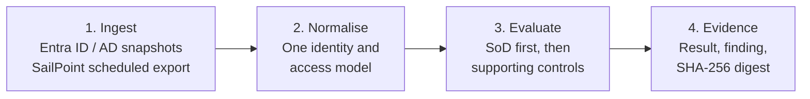

# CEF v1.0.0: IAM Control Evaluation Framework

## 1. Purpose

Evaluate identity and access state against client controls. Detect toxic combinations first. Evaluate privileged access, access certification, entitlement, authentication and migration assurance on the same model. Record each result as evidence. CEF assesses and reports only. Uplift is delivered through established IAM operational and change-management processes. 

## 2. Scope

| In scope | Out of scope |
| -------- | ------------ |
| SoD evaluation | Remediation |
| Privileged access, access certification, entitlement, authentication and migration assurance evaluation | Account provisioning and entitlement modification |
| Evidence generation | Executing migrations |
| Framework mapping and crosswalk | Defining client controls |
| | Replacing SailPoint, Entra ID or Active Directory |

## 3. Definitions

| Term | Definition |
| ---- | ---------- |
| Toxic combination | A set of entitlements that must not be held by the same identity, for example the ability to both create and approve a payment |
| Non-toxic | An access combination with no conflict against the conflict matrix |
| Conflict matrix | Client-owned list of incompatible entitlement combinations |
| Control | Client-defined requirement, expressed as an explicit assertion |
| Crosswalk | Mapping of client controls to framework controls |
| Evidence record | Structured result linking source state, assertion and outcome |

## 4. Control sources

- Derive controls from the client's enterprise material: security policies, access standards, and risk and compliance requirements.
- Evaluate client controls. CEF does not define them.
- Map client controls to the applicable frameworks (for example NZISM, ISM, Essential Eight and SOC 2). Deliver the result as a crosswalk (`docs/IAM_CONTROL_CROSSWALK.csv`).
- Trace mapped controls to risk register entries where a risk register is in scope.
- Treat `IATO` identifiers as illustrative labels for the working structure. They are not a control set.

The engagement is primarily IAM work. Framework mapping supports it.

## 5. Architecture

CEF is a source-integration and control-evaluation tool. It is not a conventional CRUD application and provides no general-purpose create, read, update or delete operations against source-system records.



## 6. Inputs

Collect all source data with read-only permissions.

| Source | Collection mechanism | Data |
| ------ | -------------------- | ---- |
| SailPoint IGA | Scheduled XML export | SailPoint objects and IGA data |
| Microsoft Entra ID | Live read-only snapshot via collector script (Microsoft Graph API) | Users, privileged role assignments, role eligibility, MFA methods and Conditional Access policies |
| Active Directory | Live read-only snapshot via collector script | Directory identities, accounts and access relationships |

- Receive SailPoint data as a scheduled export, commonly XML.
- Query Entra ID and Active Directory on demand. No scheduled dump is required.
- Extract the relevant identity, account, role and entitlement fields after collection.

### 6.1 SailPoint XML format

SailPoint objects are held as XML text files. Each object type has its own XML tag and structure.

| Tag | Object |
| --- | ------ |
| `<Rule>` | Rules |
| `<TaskDefinition>` | Tasks |
| `<EmailTemplate>` | Email templates |
| `<sailpoint>` | Wrapper element holding one or more objects |

A single-object file starts with a `DOCTYPE` declaration for that object type. It begins and ends with that object's tag:

```xml
<!DOCTYPE Rule ...>
<Rule ...>
  ...
</Rule>
```

A wrapped file declares `sailpoint` as its document type and holds several objects, which are imported together. Wrapping is the better practice:

```xml
<!DOCTYPE sailpoint ...>
<sailpoint>
  <Rule ...> ... </Rule>
  <EmailTemplate ...> ... </EmailTemplate>
</sailpoint>
```


Accept both forms: object-specific documents and multi-object exports using the `sailpoint` wrapper. Treat the export as read-only input.

## 7. Processing

### 7.1 Normalise

Map each source schema into one model, so control logic does not depend on vendor formats.

```yaml
identity:
  account:
    application:
      role:
        entitlement:

# governance relationships
identity:
  reviewer:
    certification:
      decision:
```

### 7.2 Evaluate

Express each client control as an explicit assertion. Test it against the normalised model. Evaluate across platforms, for example a SailPoint-exported entitlement combined with an Entra ID role or Active Directory group membership.

```yaml
control:
  control_id: IATO-SD-001
  domain: segregation_of_duties
  assertion: conflicting_entitlements_must_not_be_assigned
```

Organise client controls into seven IAM domains. The domains follow common IAM control families (NZISM, ISM, SOC 2 logical access) and the RBAC model. Each control record carries `control_id`, `domain` and `assertion`.

| ID | Domain | What is evaluated |
| -- | ------ | ----------------- |
| `IATO-SD` | Segregation of Duties | Conflicting entitlement combinations are not assigned |
| `IATO-PA` | Privileged Access | Privileged identities, accounts and assignments are attributable, approved and reviewed |
| `IATO-GV` | Identity Governance | Governance relationships, including certification decisions |
| `IATO-EN` | Entitlement Management | Entitlements are attributable and reviewable |
| `IATO-AC` | Access Control | Active access has an attributable identity relationship |
| `IATO-AU` | Authentication | Authentication-related control state |
| `IATO-IM` | Identity Migration | State differences between legacy IAM and Entra ID / Azure RBAC targets |

Hold conflict definitions under `policies/sod`, separate from collected identity state. Use OPA/Rego for policy evaluation where policy-as-code is used.

### 7.3 Ownership and exceptions

CEF evaluates against a conflict matrix. It does not decide what is toxic.

- **Matrix owner:** the client's business or application owner. Approve the matrix through the organisation's access governance process.
- **Risk rating:** the control owner rates each toxic pair.
- **Exceptions and compensating controls:** keep as governance records held by the control owner, with documented justification and a review date.
- **Reporting:** report the combination as found. Assess the exception against that finding through established IAM processes.

### 7.4 Migration assurance

Compare a captured legacy IAM state against an Entra ID / Azure RBAC target state. Report:

- Missing identities and orphaned accounts
- Missing entitlements and unexpected role assignments
- Access relationship and privilege changes
- SoD differences
- Legacy access remaining after migration

Observe and compare only. Do not perform the migration.

## 8. Outputs

Produce one evidence record per evaluation, linking source state to result.

```yaml
evidence:
  control_id: IATO-SD-001
  identity_state:
    identity: recorded
    account: recorded
    entitlement_relationships: recorded
  assertion:
    definition: recorded
  evaluation:
    result: fail
    timestamp: recorded
  integrity:
    algorithm: SHA-256
    digest: recorded
```

- An evidence record is not an access decision or a remediation action.
- Append records to the evidence ledger (`ledger/`) using the SHA-256 digest.

## 9. Operational boundaries

| Operation | Behaviour |
| --------- | --------- |
| Source data retrieval | Read |
| Source data modification | Prohibited |
| Account provisioning | Not performed |
| Entitlement modification | Not performed |
| Access remediation | Not performed |
| Control evaluation | Performed |
| Evidence generation | Performed |
| Evidence integrity | SHA-256 |

CEF does not replace SailPoint, Microsoft Entra ID or Active Directory. It consumes their data and evaluates the resulting identity and access state. Route findings to established IAM operational and change-management processes.

## 10. Framework references

| Framework | Relevant areas |
| --------- | -------------- |
| NZISM | Identity management, authentication, access control, privileged access, identity assurance, access governance |
| ISM | Identity and access management, authentication, privileged access, access control, identity assurance |
| Essential Eight | Restrict Administrative Privileges, Multi-Factor Authentication |

- Which frameworks apply depends on the client.
- Framework references provide context only. They create no compliance obligations and do not replace formal assessment.
- `IATO` control IDs are illustrative and independent of external framework numbering.

## 11. Repository structure

```text
iato-root/
├── .github/workflows/   validate.yml, ledger-commit.yml
├── docs/                IAM_CONTROL_CROSSWALK.csv, IDENTITY_DATA_MODEL.md,
│                        images/sailpoint-xml-object-structure.png
├── collectors/          azure/entra_snapshot.py, active_directory/ad_snapshot.py
├── policies/            access, authentication, entitlement, governance, privileged, sod
├── test/                mutations, unit
├── evidence/            generate_evidence.py, schemas
├── ledger/              scripts/hash_result.py, scripts/append_ledger.py, storage/README.md
└── requirements.txt
```
---
